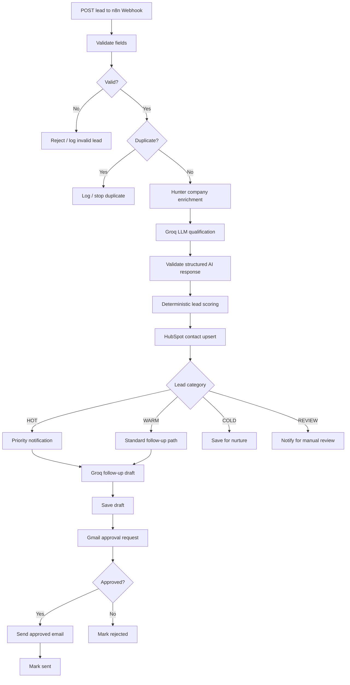
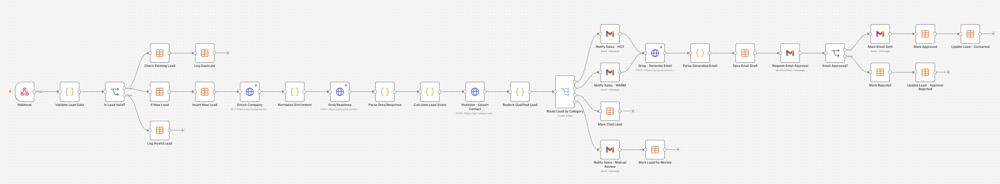
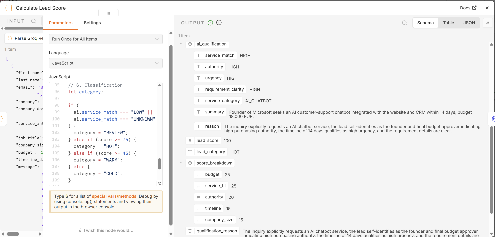
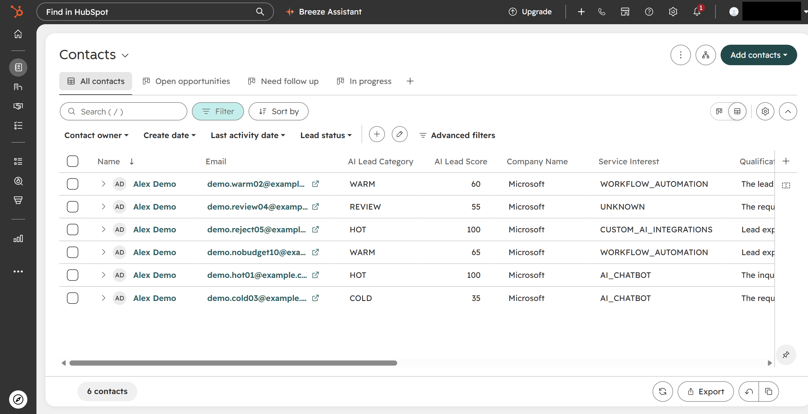
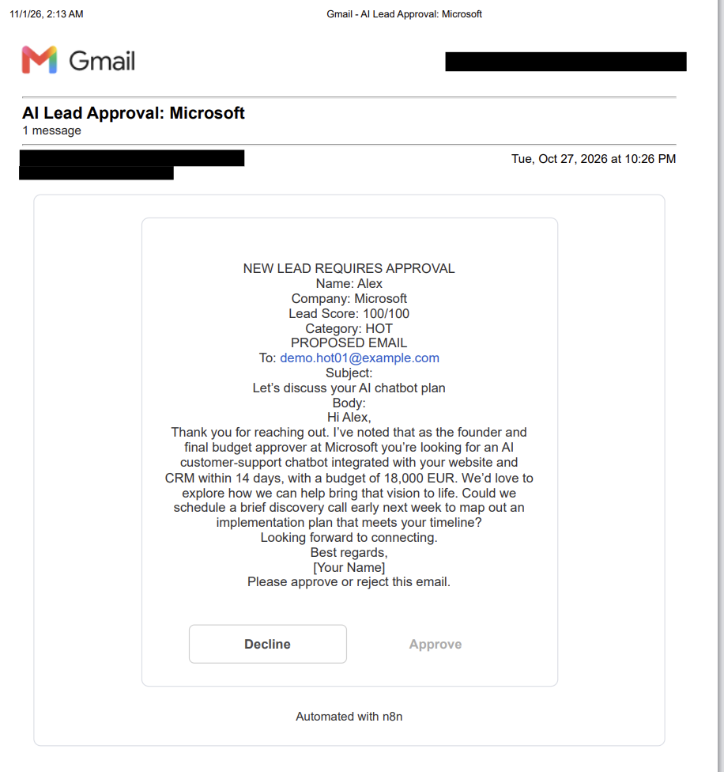
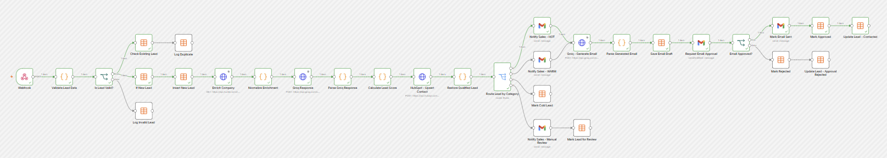
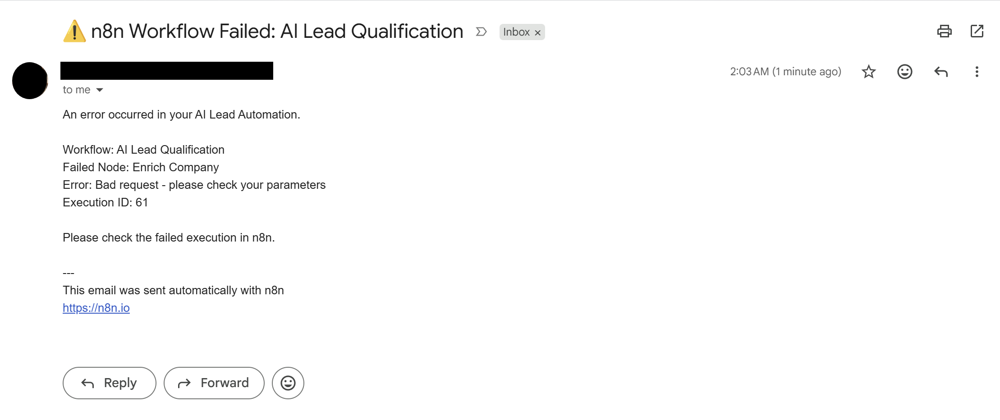

# AI Lead Qualification & CRM Automation

An n8n portfolio project that receives incoming sales inquiries, enriches company information, qualifies leads with a Groq-hosted LLM, applies deterministic scoring rules, syncs contacts with HubSpot, and supports human-approved email follow-ups using Gmail.

> **Demo project:** Built and tested locally using synthetic lead data.

## Project Status

**Completed Portfolio MVP**

The automation has been implemented and tested locally using synthetic lead data.

All 11 documented acceptance tests passed, covering lead qualification, CRM synchronization, conditional routing, email approval and rejection, duplicate detection, input validation, and centralized error notifications.

Test results and supporting screenshots are included in this repository.

## Business problem
Sales teams can spend time manually screening inquiries, entering CRM information, prioritizing leads, and drafting replies. This workflow demonstrates how those steps can be automated while retaining human review for outbound messages.

## How it works

Groq HTTP requests support retries for request failures. Invalid model responses and other unhandled execution errors trigger a separate n8n workflow that notifies the operator by email.

## Technology
- n8n, self-hosted with Docker
- Postman for webhook tests
- Hunter company enrichment API
- Groq Chat Completions API
- HubSpot CRM API
- Gmail OAuth2 and human approval
- n8n Data Tables for draft state and basic logging

## Sample scoring policy
| Criterion | Maximum points |
| --- | ---: |
| Budget suitability | 25 |
| Service match | 25 |
| Decision authority | 20 |
| Timeline | 15 |
| Company size | 15 |
| **Total** | **100** |

Lead categories are assigned using the following rules:

- **HOT:** Score of 75–100.
- **WARM:** Score of 45–74.
- **COLD:** Score below 45.
- **REVIEW:** Service match is LOW or UNKNOWN, regardless of the numerical score.

The final category is determined by deterministic scoring rules using the validated AI qualification output.

## Local setup
1. Start your n8n instance. Secure it before exposing it outside localhost.
2. Import the actual workflow JSON exports from `workflows/` using n8n's workflow import menu.
3. Create your own Hunter, Groq and HubSpot credentials; configure Gmail OAuth2 separately.
4. Reconnect all credential references. Imported workflows do **not** provide functional API credentials.
5. Create the required HubSpot contact properties and n8n Data Tables, as shown in your workflow setup.
6. Test using the Postman collection in `postman/`, starting with n8n's test webhook URL. The production URL requires a published workflow.
7. During testing, direct all outgoing email to a mailbox you own.

**Important:** Workflow JSON exports, screenshots, execution samples, and Postman environments may contain personal information, local URLs, credential references or tokens. Review and sanitize them before committing. Do not commit `.env` or credentials.

## Testing & Validation

The workflow was tested using Postman with synthetic lead data.

11 test scenarios were executed, covering:

- HOT, WARM, COLD, and REVIEW classification
- Email approval and rejection
- Duplicate lead detection
- Invalid input validation
- Missing and negative budget handling
- Centralized workflow error notifications

**Results: 11/11 recorded as passed.**

See the [Acceptance Test Checklist](docs/acceptance-checklist.md)
for the test scenarios, expected behavior, and actual results.

The [Postman Collection](postman/ai-lead-qualification-tests.postman_collection.json)
contains the sample API requests used for testing.

## Demo & Screenshots

The screenshots below show the main components of the automation
using synthetic test leads.

### 1. Workflow Overview

End-to-end workflow for lead validation, enrichment,
AI qualification, CRM synchronization, routing, and email approval.

### 2. AI Qualification & Lead Scoring

Groq evaluates service fit, purchasing authority, urgency,
and requirement clarity.

JavaScript applies weighted scoring rules to classify leads
as HOT, WARM, COLD, or REVIEW.

### 3. HubSpot CRM Integration

Lead scores and qualification categories are synchronized
with HubSpot contact records.

### 4. Human-in-the-Loop Email Approval

Groq generates personalized follow-up emails.
A salesperson can approve or decline them before sending.

### 5. Conditional Lead Routing

HOT, WARM, COLD, and REVIEW leads follow different
processing paths based on qualification results.

### 6. Error Notifications

A separate error-handling workflow sends Gmail notifications
when an unhandled workflow execution fails.

### Video Demonstration

A short walkthrough of the complete AI Lead Qualification
and CRM Automation workflow will be added here.

## Production Considerations

This project is a tested portfolio MVP built with synthetic lead data.

For deployment in a real business environment, the following
improvements should be considered:

- **API resilience:** Add fallback handling for enrichment and external API failures.
- **Email reliability:** Implement stronger duplicate-send prevention and delivery tracking.
- **Security and privacy:** Configure secure hosting, webhook authentication, data retention, and GDPR-compliant handling of customer information.